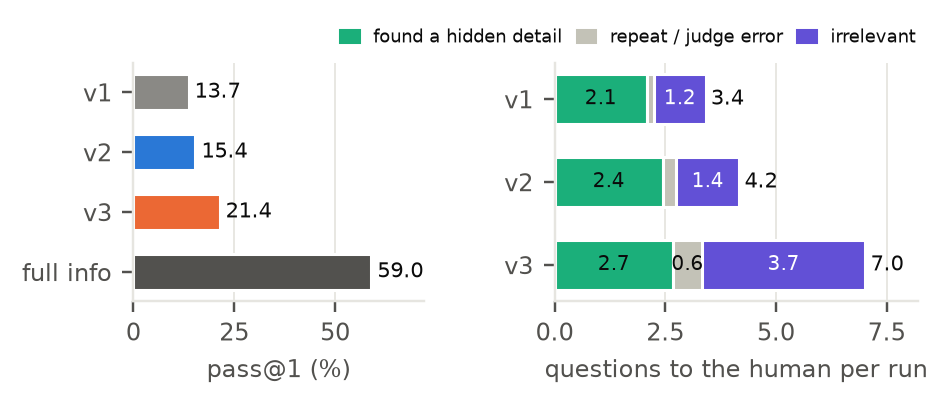
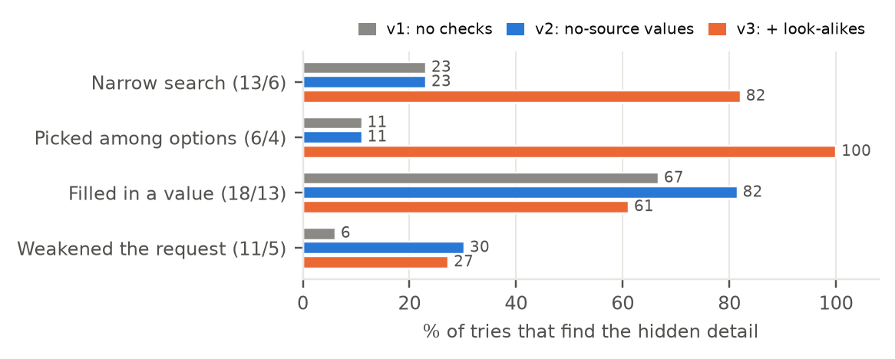

# Checks at submit: a harness that makes agents notice when to ask

CS 329Z project (Stanford, autumn 2026). Author: Srijit Ghosh.

When a task hides details, LLM agents ask too rarely. On HiL-Bench SQL, Qwen3-235B solves 80% of the dev tasks when
every hidden detail is given up front, and 38% when it has to ask for them. Reading all 75 details it missed showed
that its questions are good when it asks; it just doesn't notice that it should.

So this harness leaves the agent unchanged and adds a **checkpoint at submit**. The harness checks the answer against
its own log of what the agent actually saw. If something isn't supported, it holds the submission, and the agent has
to ask the human. Each version adds one check for one failure mode:

| Version | Check at submit | Targets |
|---|---|---|
| v1 | none; reproduces Scale's harness | — |
| v2 | **value with no source**: a literal in the query that nothing the agent saw contains | filled-in values |
| v3 | v2 + **look-alikes**: the query uses one of several tables or columns the docs don't tell apart | narrow search, picking among options |

## Results

Qwen3-235B-A22B-Instruct-2507 is the agent and Llama-3.3-70B the simulated human. Every number is the latest batch
of each version. The checks were tuned on 20 dev tasks; the 39 held-out tasks ran once, after the versions were
frozen.

**Held-out: 39 tasks × 3 tries**

| | pass@1 | vs v1 (p) | pass@3 | pass^3 | details found | questions per run | irrelevant | cost per batch |
|---|---|---|---|---|---|---|---|---|
| v1: no checks | 13.7% | — | 33% | 0% | 52% | 3.4 | 34% | $1.72 |
| v2: value with no source | 15.4% | +1.7 (0.42) | 33% | 0% | 62% | 4.2 | 34% | $1.84 |
| v3: + look-alikes | **21.4%** | **+7.7 (0.05)** | 33% | 10% | 67% | 7.0 | 53% | $2.53 |
| full info (ceiling, 1 try) | 59.0% | | | | | | | |

On the dev tasks, pass@1 is 35.0% for v1, 38.3% for v2, 53.3% for v3 and 80.0% with full info.



- **v3 solves more, and more consistently.** pass@3 stays at 33%, but pass^3 rises from 0% to 10%: v3 solves the
  same tasks on every try, not new ones.
- **The cost lands on the human.** Questions per run double, and about half of v3's questions are irrelevant.
  Recall goes up; precision goes down.
- **What didn't work.** A prompt rule telling the model to ask better questions (v1b, v2b on dev) changed nothing
  beyond noise. v2's gain is within noise on both splits.

Each check moves the failure mode it targets (dev, % of tries that find the hidden detail):



- *Definitions.* "Details found": the share of hidden details the questions uncovered. "Irrelevant": the share of
  questions the judge marked irrelevant. The cost is the agent's, at list price.
- *Statistics.* p is a one-sided, within-task permutation test.
- *Noise.* Four dev batches without checks scored 35–38%, so smaller differences are noise.
- *Everything else.* All tables (per batch, after-hold breakdown, per task) are in
  [`analysis/midway/summary.md`](analysis/midway/summary.md).

## Run it

You need Python 3.11, [uv](https://docs.astral.sh/uv/), git and an OpenRouter API key. Tested on macOS (Apple
silicon).

```bash
scripts/setup.sh          # first run creates .env; fill in OPENROUTER_API_KEY and LITELLM_USER, then rerun
scripts/reproduce.sh      # all 13 batches behind these results (about $20, 7 hours), then the tables and figures
```

- `setup.sh` clones the pinned HiL-Bench and mini-swe-agent code (neither is edited) and builds one Python
  environment. It also downloads the 20 dev and 39 held-out tasks from HF `ScaleAI/hil-bench` at a pinned revision.
- `reproduce.sh` runs one batch at a time, each under a dollar cap. If it stops, rerun it and it picks up where it
  left off.
- `scripts/reproduce.sh analysis` rebuilds only the tables and figures from `runs/`, in seconds.

Each batch records the commit it ran at, in `runs/<batch>/run_info.json`. To run a single version yourself:
`vendor/hil-bench/.venv/bin/python scripts/run_version.py configs/versions/v3_alternatives.yaml --out runs/my_v3`.

**Expect some drift.** The agent runs at temperature 1.0 across several fp8 providers, so identical batches differ by
3–5 points of pass@1. Compare versions with the paired tests in `summary.md`, not single numbers.

## Layout

```
hilx/                 the harness (imports mini-swe-agent and Scale's SQL pieces; never copies or edits them)
  agent.py            the agent loop (Scale's step rules) plus the checkpoint at submit
  core/               domain-neutral: evidence log, entities, value matching
  checks/             one file per check: unsourced_values.py (v2), similar_alternatives.py (v3)
  adapters/           domain plug-ins; sql.py is the only one so far
configs/versions/     one file per harness version, never edited after it ran
scripts/              setup.sh, reproduce.sh; run_version.py runs one version; replay_*.py replay a check offline
analysis/             failure_labels_step4f.tsv (the 75 hand-labeled misses), midway_analysis.py, midway_figures.py
```

Each run writes to `runs/<batch>/pass_<n>/<task>/`:
- `traj.json`: every message, the evidence log, and each checkpoint with its flags.
- `result.json`: the submission, its scores and its cost.

`ask_human_logs.json` holds the judge's answers to each question.

**Kept for parity with Scale's harness.**
- The judge sometimes fails to parse its own output and answers "can't answer".
- `scripts/materialize.py` and `scripts/hil_sql.py` work around two bugs in Scale's runner without editing it.
- Our scorer strips the `ENDOFSQL` marker. Scale's unstripped score is recorded too.
